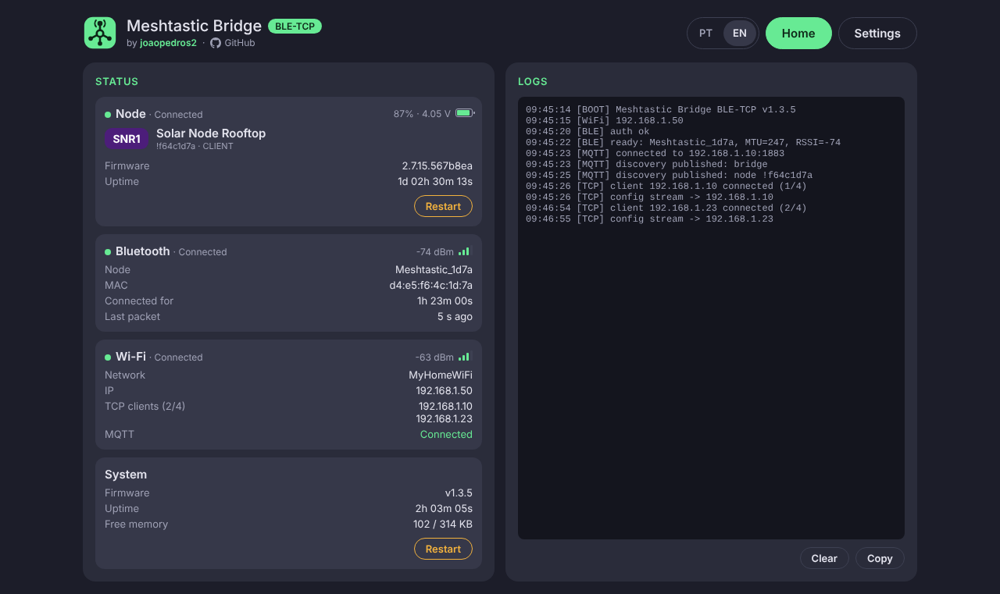
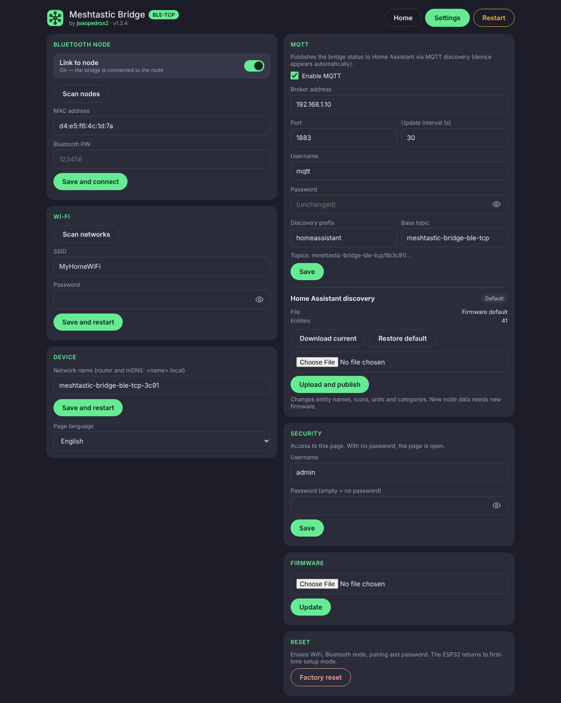

# Meshtastic Bridge BLE-TCP

**English** · [Português (PT)](README.pt-PT.md)

ESP32 firmware that makes a **Bluetooth-only Meshtastic node** reachable over your network.

The ESP32 sits next to the node, connects to it over Bluetooth LE, and exposes the standard Meshtastic **TCP API on port 4403**. The Meshtastic apps, Home Assistant or any other client can then connect to the node by IP — at home or remotely via VPN — with no PC left running.

Built for nRF52 nodes such as the SenseCAP Solar Node, RAK4631, T-Echo or T1000-E, which have no Wi-Fi.



## Features

- **BLE → TCP bridge** on port 4403, compatible with the Meshtastic apps (Android, iOS, Windows), the Python CLI and Home Assistant
- **Up to 4 clients at once** (e.g. Home Assistant and the app); live mesh traffic goes to all, config requests are served one at a time
- **Web page** (EN / PT-PT, desktop and mobile): status, logs, Bluetooth node scan, Wi-Fi setup, hostname, page login
- **First-time setup access point** — no credentials or node address are built into the firmware
- **MQTT with Home Assistant discovery**: bridge and node diagnostics (signal, link state, battery, channel utilization, nodes online, packet counters, noise floor…) plus Restart, Bluetooth reconnect and Bluetooth link controls
- **OTA updates** from the browser
- mDNS (`meshtastic-bridge-ble-tcp-xxxx.local`) so apps can discover the bridge
- Node card on the status page (battery, name, firmware, uptime) and a **Restart** button
- Automatic BLE reconnect with backoff and dead-link detection



## Hardware

Any ESP32 with **Wi-Fi + Bluetooth LE** and **at least 4 MB flash**:

| Board | Environment | Release file | Status |
|---|---|---|---|
| ESP32 DevKit (ESP32-WROOM-32) | `esp32dev` | `…-esp32.bin` | ✅ Tested (default) |
| ESP32-S3 DevKit | `esp32s3` | `…-esp32s3.bin` | 🟡 Builds — not tested yet |
| ESP32-C3 DevKit | `esp32c3` | `…-esp32c3.bin` | 🟡 Builds — not tested yet |
| ESP32-C6 DevKit | `esp32c6` | `…-esp32c6.bin` | 🟡 Builds — not tested yet |
| Seeed Studio XIAO ESP32-C3 | `xiao_esp32c3` | `…-xiao-esp32c3.bin` | 🟡 Builds — not tested yet |
| Seeed Studio XIAO ESP32-S3 | `xiao_esp32s3` | `…-xiao-esp32s3.bin` | 🟡 Builds — not tested yet |
| Other ESP32 boards | see below | — | 🟡 Build it yourself |
| ESP32-S2 (no Bluetooth), ESP32-H2 (no Wi-Fi) | — | — | ❌ Not possible |

Bluetooth range is the main limit: aim for a BLE RSSI better than about −85 dBm. A board with an external antenna (e.g. XIAO ESP32-C3 or XIAO ESP32-S3, with the antenna connected) helps both Bluetooth and Wi-Fi.

Each [release](https://github.com/joaopedros2/meshtastic-bridge-ble-tcp/releases) has one `.bin` per board in the table, built automatically by GitHub Actions. Pick the file for your chip: a `.bin` for another chip does not run. For any other board, build it yourself as below.

### Using another board

1. Find your board's id in the [PlatformIO board list](https://docs.platformio.org/en/latest/boards/index.html#espressif-32) (e.g. `esp32-s3-devkitc-1`, `esp32-c6-devkitc-1`).
2. Add an environment to `platformio.ini` that reuses the default one:

   ```ini
   [env:my_board]
   extends = env:esp32dev
   board = esp32-s3-devkitc-1
   build_flags =
       -DARDUINO_USB_MODE=1
       -DARDUINO_USB_CDC_ON_BOOT=1  ; only for boards with native USB (S3, C3, C6), so logs show on that port
   ```

3. Build and flash it: `pio run -e my_board -t upload` (or pick `env:my_board` in the VS Code status bar).
4. The first flash of a new board must be over USB; if it isn't detected, hold **BOOT** while plugging it in. Later updates can go through **Settings → Firmware** with `.pio/build/my_board/firmware.bin`.

The board needs at least 4 MB of flash (two app slots for web updates). If it works on a board not listed here, please open an issue so it can be added to the table.

## Build and flash

Requires [PlatformIO](https://platformio.org/) (VS Code extension or CLI).

```bash
git clone https://github.com/joaopedros2/meshtastic-bridge-ble-tcp.git
cd meshtastic-bridge-ble-tcp
pio run -t upload
pio device monitor
```

This builds the default `esp32dev` environment. For another board in the table use its environment, e.g. `pio run -e xiao_esp32c3 -t upload`; for other boards see [Using another board](#using-another-board).

> **Windows:** keep the project in a path without accents or spaces (e.g. `C:\dev\`), otherwise the linker fails.

Later updates can be done from **Settings → Firmware** with `.pio/build/<environment>/firmware.bin` or your board's `.bin` from the [releases](https://github.com/joaopedros2/meshtastic-bridge-ble-tcp/releases).

## First-time setup

1. Power the ESP32. It opens the Wi-Fi network **`meshtastic-bridge-ble-tcp-XXXX`** (password `meshtastic`).
2. Join it — the setup page opens on its own (otherwise go to `http://192.168.4.1`).
3. **Settings → Wi-Fi**: pick your network and save. The bridge restarts and joins it.
4. **Settings → Bluetooth node**: scan, pick your node, enter its PIN and save.
   Nodes with a screen show a random PIN — set them to **Fixed PIN** in the Meshtastic app first (default `123456`).
5. Make sure no phone or PC is connected to the node over Bluetooth: a node accepts only one BLE connection.

### Several bridges

Use one bridge per node. Each one gets its own name from the chip id (`XXXX`, the same as its setup network):
`meshtastic-bridge-ble-tcp-xxxx` on the network and `.local`, and **Meshtastic Bridge BLE-TCP XXXX** in Home Assistant.
To use a name of your own (e.g. `bridge-solar-roof`), set it in **Settings → Wi-Fi** (Hostname) — ideally before enabling MQTT, so the HA entity ids are created with it. MQTT topics and discovery ids always include the chip id, so bridges never clash.

## Connecting

- **Meshtastic app:** connection type *Network*, address = the bridge IP (or pick it from the scan).
- **Home Assistant:** the [Meshtastic integration](https://github.com/meshtastic/home-assistant) with a TCP connection to the bridge IP, port 4403.
- **Python CLI:** `meshtastic --host <bridge-ip> --info`

## MQTT / Home Assistant

Enable it in **Settings → MQTT** (broker, port, user, password). Topics live under `meshtastic-bridge-ble-tcp/<chip-id>/`, discovery under `homeassistant/`.

Two devices appear in Home Assistant:

- **The bridge** (`Meshtastic Bridge BLE-TCP XXXX`): Bluetooth connected, Bluetooth state, Bluetooth RSSI, Bluetooth connected for, Bluetooth reconnects, TCP clients; controls: Restart, Bluetooth reconnect (buttons), Bluetooth link (switch); diagnostics: status, node Bluetooth name, Wi-Fi SSID, Wi-Fi RSSI, IP, uptime, free memory, DNS address, Wi-Fi MAC address, internal temperature.
- **The node** (`Meshtastic Node 1D7A`, from the last 4 digits of its node id), linked to the bridge (model, firmware and node id as serial number): Restart button, position (device tracker, when the node shares one), battery, voltage, channel utilization, airtime TX, uptime, online / known nodes, packets RX / TX / RX bad, noise floor; diagnostics: packets RX duplicate, packets relayed, relays canceled, packets TX dropped, free / total memory, firmware, hardware, role, radio, ID, long name, short name, external power.

Ids come from hardware, never from names: the bridge uses its chip id (`mbb_5b3c91_…`, `sensor.meshtastic_bridge_5b3c91_…`) and the node its node number (`mbn_f64c1d7a_…`, `sensor.meshtastic_f64c1d7a_…`). Renaming the node in the Meshtastic app only changes the *Long name* / *Short name* entities; device name, entity ids, history, dashboards and automations stay the same. If the bridge is pointed at another node, the old node's device is removed.

Node values come from the telemetry the node sends to its client (every minute) and its local stats (every 15 min), so they update while a client (app, Home Assistant…) is connected. Entities go *unavailable* in HA when the bridge is offline.

### Changing the entities

The entities are defined in `include/ha_entities.h` (name, unit, icon, category). To change them, edit that file and update the firmware; keep each `key` so the HA entity keeps its history.

### HTTP API

`GET /api/status` returns everything the bridge knows, including every value read from the node (identity, radio, battery, channel use, uptime and the local stats: nodes, packet counters, noise floor, free memory). Fields that have not been received yet are `null`.

## Security notes

- Port 4403 has no authentication (same as Meshtastic's own TCP API). Keep the bridge on a trusted network or behind a VPN.
- Set a page password in **Settings → Security**.
- MQTT is unencrypted (no TLS), intended for a local broker.

## License

MIT — see [LICENSE](LICENSE).

Meshtastic® is a registered trademark of Meshtastic LLC. This project is independent and not affiliated with or endorsed by Meshtastic LLC.

Developed by **joaopedros2**.
