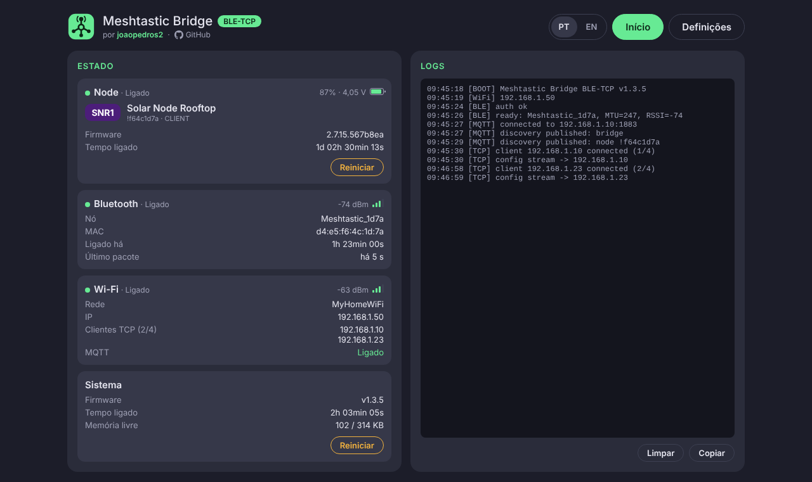
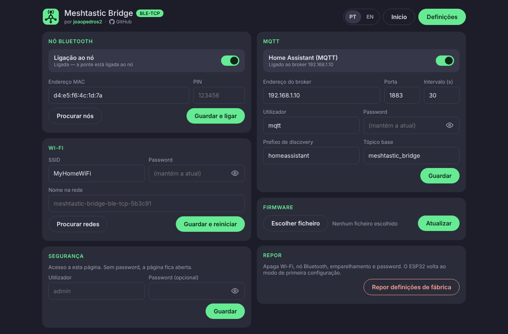

# Meshtastic Bridge BLE-TCP

[English](README.md) · **Português (PT)**

Firmware para ESP32 que torna um **nó Meshtastic só com Bluetooth** acessível pela tua rede.

O ESP32 fica junto do nó, liga-se a ele por Bluetooth LE e disponibiliza a **API TCP padrão do Meshtastic na porta 4403**. As apps Meshtastic, o Home Assistant ou qualquer outro cliente passam a ligar-se ao nó pelo IP — em casa ou à distância por VPN — sem precisares de um PC sempre ligado.

Feito para nós nRF52 sem Wi-Fi, como o SenseCAP Solar Node, RAK4631, T-Echo ou T1000-E.



## Funcionalidades

- **Ponte BLE → TCP** na porta 4403, compatível com as apps Meshtastic (Android, iOS, Windows), a CLI Python e o Home Assistant
- **Até 4 clientes ao mesmo tempo** (por exemplo, o Home Assistant e a app); o tráfego da mesh chega a todos, e os pedidos de configuração são atendidos um de cada vez
- **Página web** (EN / PT-PT, computador e telemóvel): estado, logs, procura do nó Bluetooth, configuração do Wi-Fi, nome na rede, login da página
- **Rede de configuração inicial** — o firmware não traz credenciais nem endereço do nó
- **MQTT com discovery do Home Assistant**: diagnóstico da ponte e do nó (sinal, estado da ligação, bateria, utilização do canal, nós online, contadores de pacotes, noise floor…) e controlos Restart, Bluetooth reconnect e Bluetooth link
- **Atualizações OTA** pelo browser
- mDNS (`meshtastic-bridge-ble-tcp-xxxx.local`) para as apps encontrarem a ponte
- Cartão do nó na página de estado (bateria, nome, firmware, tempo ligado) e botão **Reiniciar**
- Reconexão Bluetooth automática, com espera crescente e deteção de ligação morta



## Hardware

Qualquer ESP32 com **Wi-Fi + Bluetooth LE** e **pelo menos 4 MB de flash**:

| Placa | `board` no `platformio.ini` | Estado |
|---|---|---|
| ESP32 DevKit (ESP32-WROOM-32) | `esp32dev` | ✅ Testada — ambiente predefinido, `.bin` dos releases |
| Seeed Studio XIAO ESP32-C3 | `seeed_xiao_esp32c3` | 🟡 Deve funcionar — ambiente `xiao_esp32c3` já preparado, ainda não testada |
| Outras placas ESP32, ESP32-S3, ESP32-C3, ESP32-C6 | ver abaixo | 🟡 Devem funcionar — não testadas |
| ESP32-S2 (sem Bluetooth), ESP32-H2 (sem Wi-Fi) | — | ❌ Não é possível |

O alcance do Bluetooth é o principal limite: procura um RSSI BLE melhor que cerca de −85 dBm. Uma placa com antena externa (por exemplo, XIAO ESP32-C3 ou XIAO ESP32-S3, com a antena ligada) ajuda o Bluetooth e o Wi-Fi.

O firmware dos [releases](https://github.com/joaopedros2/meshtastic-bridge-ble-tcp/releases) é compilado só para `esp32dev` (ESP32 clássico). Para qualquer outra placa, compila-o tu, como explicado abaixo.

### Usar outra placa

1. Procura o identificador da tua placa na [lista de placas do PlatformIO](https://docs.platformio.org/en/latest/boards/index.html#espressif-32) (por exemplo, `esp32-s3-devkitc-1`, `esp32-c6-devkitc-1`).
2. Acrescenta ao `platformio.ini` um ambiente que reutiliza o predefinido:

   ```ini
   [env:my_board]
   extends = env:esp32dev
   board = esp32-s3-devkitc-1
   build_flags =
       -DARDUINO_USB_MODE=1
       -DARDUINO_USB_CDC_ON_BOOT=1  ; só para placas com USB nativo (S3, C3, C6), para os logs aparecerem nessa porta
   ```

3. Compila e grava: `pio run -e my_board -t upload` (ou escolhe `env:my_board` na barra de baixo do VS Code).
4. A primeira gravação de uma placa nova tem de ser por USB; se não for detetada, mantém premido o botão **BOOT** enquanto a ligas. As atualizações seguintes podem ser feitas em **Definições → Firmware**, com `.pio/build/my_board/firmware.bin`.

A placa precisa de pelo menos 4 MB de flash (duas partições de firmware para as atualizações pela página). Se funcionar numa placa que não está na tabela, abre uma issue para a acrescentarmos.

## Compilar e gravar

É preciso o [PlatformIO](https://platformio.org/) (extensão do VS Code ou CLI).

```bash
git clone https://github.com/joaopedros2/meshtastic-bridge-ble-tcp.git
cd meshtastic-bridge-ble-tcp
pio run -t upload
pio device monitor
```

Isto compila o ambiente predefinido `esp32dev`. Para o XIAO ESP32-C3 usa `pio run -e xiao_esp32c3 -t upload`; para outras placas vê [Usar outra placa](#usar-outra-placa).

> **Windows:** guarda o projeto num caminho sem acentos nem espaços (por exemplo, `C:\dev\`), senão o linker falha.

As atualizações seguintes podem ser feitas em **Definições → Firmware**, com o `.pio/build/esp32dev/firmware.bin` ou o `.bin` dos [releases](https://github.com/joaopedros2/meshtastic-bridge-ble-tcp/releases).

## Primeira configuração

1. Liga o ESP32. Ele abre a rede Wi-Fi **`meshtastic-bridge-ble-tcp-XXXX`** (password `meshtastic`).
2. Liga-te a ela — a página de configuração abre sozinha (senão, vai a `http://192.168.4.1`).
3. **Definições → Wi-Fi**: escolhe a tua rede e guarda. A ponte reinicia e liga-se a ela.
4. **Definições → Nó Bluetooth**: procura, escolhe o teu nó, escreve o PIN e guarda.
   Os nós com ecrã mostram um PIN aleatório — põe-nos primeiro em **Fixed PIN** na app Meshtastic (predefinido `123456`).
5. Confirma que nenhum telemóvel ou PC está ligado ao nó por Bluetooth: o nó só aceita uma ligação BLE.

### Várias pontes

Usa uma ponte por nó. Cada uma tem um nome próprio a partir do ID do chip (`XXXX`, o mesmo da rede de configuração):
`meshtastic-bridge-ble-tcp-xxxx` na rede e no `.local`, e **Meshtastic Bridge BLE-TCP XXXX** no Home Assistant.
Para usares um nome teu (por exemplo, `bridge-solar-telhado`), define-o em **Definições → Wi-Fi** (Nome na rede) — de preferência antes de ativar o MQTT, para os IDs das entidades no HA já nascerem com ele. Os tópicos MQTT e os IDs do discovery incluem sempre o ID do chip, por isso as pontes nunca entram em conflito.

## Ligar

- **App Meshtastic:** tipo de ligação *Rede*, endereço = IP da ponte (ou escolhe-a na pesquisa).
- **Home Assistant:** a [integração Meshtastic](https://github.com/meshtastic/home-assistant) com ligação TCP ao IP da ponte, porta 4403.
- **CLI Python:** `meshtastic --host <ip-da-ponte> --info`

## MQTT / Home Assistant

Ativa em **Definições → MQTT** (broker, porta, utilizador, password). Os tópicos ficam em `meshtastic-bridge-ble-tcp/<id-do-chip>/` e o discovery em `homeassistant/`.

Aparecem dois dispositivos no Home Assistant:

- **A ponte** (`Meshtastic Bridge BLE-TCP XXXX`): Bluetooth connected, Bluetooth state, Bluetooth RSSI, Bluetooth connected for, Bluetooth reconnects, TCP clients; controlos: Restart, Bluetooth reconnect (botões), Bluetooth link (switch); diagnóstico: status, nome Bluetooth do nó, SSID e RSSI do Wi-Fi, IP, uptime, memória livre, endereço DNS, MAC do Wi-Fi, temperatura interna.
- **O nó** (`Meshtastic Node 1D7A`, a partir dos últimos 4 dígitos do ID do nó), ligado através da ponte (modelo, firmware e ID do nó como número de série): botão Restart, posição (device tracker, quando o nó a partilha), bateria, tensão, utilização do canal, airtime TX, uptime, nós online / conhecidos, pacotes RX / TX / RX com erro, noise floor; diagnóstico: pacotes RX duplicados, retransmitidos, retransmissões canceladas, TX descartados, memória livre / total, firmware, hardware, função, rádio, ID, nome longo, nome curto, alimentação externa.

Os nomes das entidades no HA ficam em inglês, como na integração Meshtastic.

Os IDs vêm do hardware, nunca dos nomes: a ponte usa o ID do chip (`mbb_5b3c91_…`, `sensor.meshtastic_bridge_5b3c91_…`) e o nó o seu número (`mbn_f64c1d7a_…`, `sensor.meshtastic_f64c1d7a_…`). Mudar o nome do nó na app Meshtastic só altera as entidades *Long name* / *Short name*; o nome do dispositivo, os IDs das entidades, o histórico, os dashboards e as automações ficam iguais. Se a ponte passar a ligar-se a outro nó, o dispositivo do nó antigo é removido.

Os valores do nó vêm da telemetria que ele envia ao cliente (a cada minuto) e das estatísticas locais (a cada 15 min), por isso atualizam enquanto houver um cliente ligado (app, Home Assistant…). As entidades ficam *indisponíveis* no HA quando a ponte está desligada.

### Alterar as entidades

As entidades estão definidas em `include/ha_entities.h` (nome, unidade, ícone, categoria). Para as mudar, edita esse ficheiro e atualiza o firmware; mantém cada `key` para a entidade no HA manter o histórico.

### API HTTP

`GET /api/status` devolve tudo o que a ponte sabe, incluindo todos os valores lidos do nó (identidade, rádio, bateria, utilização do canal, uptime e estatísticas locais: nós, contadores de pacotes, noise floor, memória). Os campos que ainda não chegaram vêm a `null`.

## Notas de segurança

- A porta 4403 não tem autenticação (tal como a API TCP do próprio Meshtastic). Mantém a ponte numa rede de confiança ou atrás de uma VPN.
- Define uma password para a página em **Definições → Segurança**.
- O MQTT não é cifrado (sem TLS) e foi pensado para um broker local.

## Licença

MIT — ver [LICENSE](LICENSE).

Meshtastic® é uma marca registada da Meshtastic LLC. Este projeto é independente e não é afiliado nem apoiado pela Meshtastic LLC.

Desenvolvido por **joaopedros2**.
